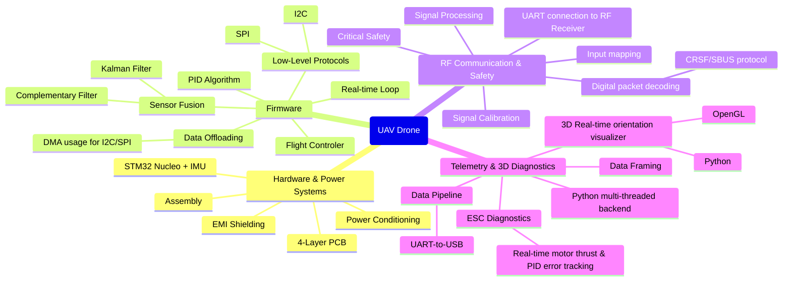
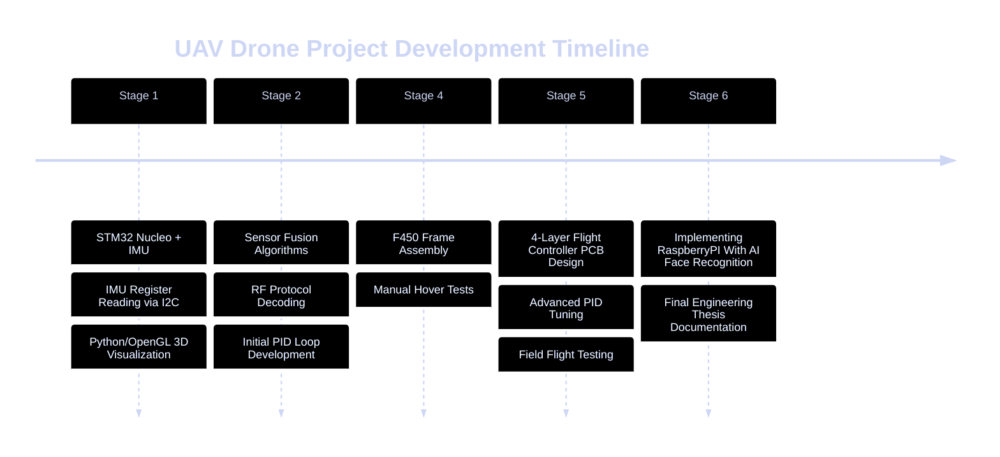

# Custom UAV Flight Controller Project (STM32)

A professional, from-scratch engineering project aimed at developing a manual quadcopter flight controller using STM32, focused on real-time systems, signal processing, and low-level hardware integration.

---

## Project Architecture & Tech Stack

The mindmap below outlines the core engineering domains, communication protocols, and algorithms utilized in this project.

---

## Project Timeline & Stage Roadmap

---

## Detailed Engineering Task Checklist

*Status: Tracking Stage 1 objectives.*

### 1. Hardware & Power Systems
- [x] Select and verify IMU sensors (BMI270/LSM6DSOX)
- [ ] **Assemble a solderless desktop prototyping rig (Nucleo + IMU)** `<- IN PROGRESS`
- [ ] Design the flight controller schematic diagrams (KiCad/Altium)
- [ ] Route the 4-layer PCB layout with dedicated GND shielding planes
- [ ] Solder components and perform Low-ESR power delivery validation

### 2. Firmware (STM32 / Embedded C)
- [ ] Configure low-level I2C/SPI peripheral drivers for IMU data streaming
- [ ] Implement a non-blocking DMA pipeline for sensor acquisition
- [ ] Develop the Kalman Filter algorithm for precise angle estimation
- [ ] Set up a hardware timer ISR for a deterministic 400Hz control loop
- [ ] Code the Motor Mixer and configure stable hardware PWM outputs for ESCs
- [ ] Implement and tune the triple-loop PID orientation controller

### 3. RF Communications & Safety
- [ ] Interface the RF Receiver with the STM32 via Hardware UART
- [ ] Implement a fast packet parser for CRSF/SBUS digital protocols
- [ ] Design stick input mapping, deadbands, and calibration routines
- [ ] Develop a 2-stage Failsafe state machine (Self-leveling -> Throttle ramp-down -> Hard cutoff)

### 4. Telemetry & PC Diagnostics
- [ ] Establish high-speed UART-to-USB telemetry data streaming
- [ ] Design a robust binary data framing protocol with CRC checksums
- [ ] Build a multi-threaded Python backend for non-blocking serial acquisition
- [ ] Implement the real-time 3D OpenGL orientation visualizer
- [ ] Create GUI diagnostic graphs for PID tracking and real-time ESC output monitoring
